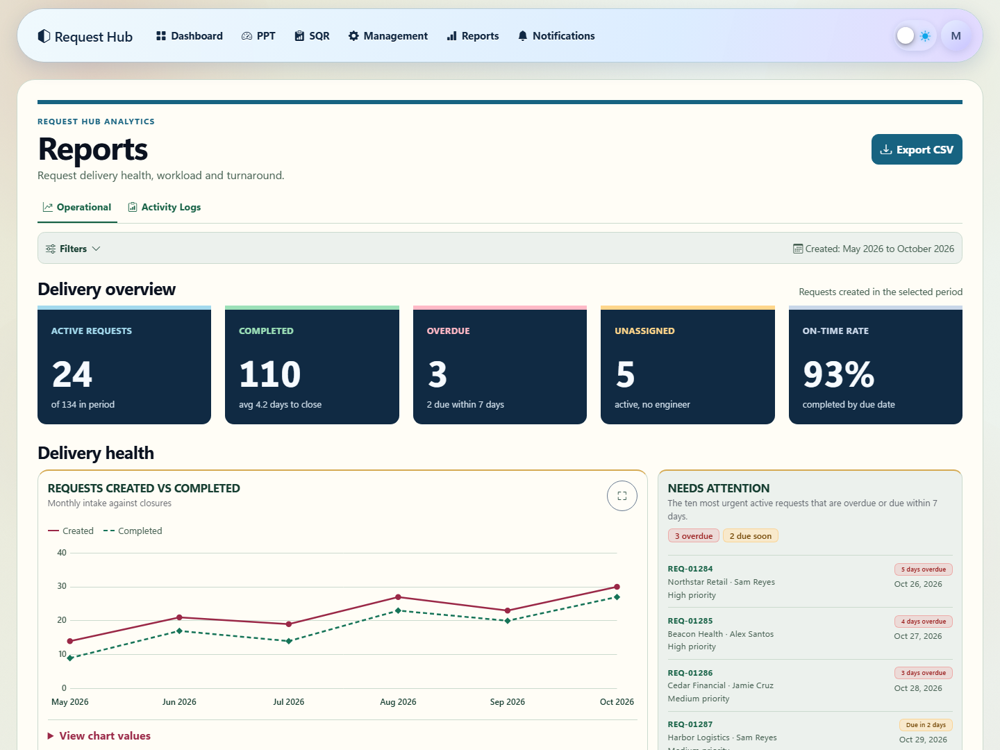

  

# Request Hub

**Manage engineering requests from intake to closeout.**

Request Hub gives Phil-Data’s Enterprise Services Group one place to assign work, track service deadlines, log engineering activity, and review quotations and project delivery.

[Explore features](#features) · [See the interface](#ui-preview) · [Get started](#get-started)

## Table of contents

- **Use the portal:** [Workflow](#workflow) · [UI preview](#ui-preview) · [Features](#features) · [Role permissions](#role-permissions)
- **Get help:** [Get started](#get-started) · [User and maintainer guides](#guides)
- **Follow updates:** [Release changelogs](#release-changelogs-and-visual-evidence) · [License](#license)

## Workflow

> **Created → Assigned → Acknowledged → Ongoing → Completed**

1. **Submit** a request and get a reference code to track it.
2. **Assign** a primary engineer and, when needed, a backup. The dashboard flags overdue work.
3. **Deliver** the work, post updates, and log engineering activity.
4. **Close and review** the request. Link a service quotation when applicable.

## UI preview

*Operational Reports shown with synthetic data.*

## Features

- **Request management:** Track priorities, assignments, service deadlines, and status in one timeline.
- **Updates and notifications:** Keep conversations with the request and use mentions to alert eligible teammates.
- **Service quotations and project performance:** Track quotations in SQR and review schedule, budget or effort, and quality in Project Performance Tracking (PPT).
- **Dashboards and reports:** Review request trends, workload, and billable activity with role-appropriate views.

## Role permissions

- **Requestors** submit and track their own requests.
- **Engineers** work on assigned requests, record progress, and log time when eligible.
- **Project managers and admins** review and coordinate work within their assigned scope.

See the [full role guide](./docs/using-request-hub.md#role-permissions) for the difference between ESS and ESG access.

## Get started

Sign in to Request Hub and open **Dashboard** to find your requests. Open **Notifications** for assignments, mentions, and release notes. For access, contact your internal support team.

## Guides

- **Using the portal:** [Workflow, roles, reports, and quotations](./docs/using-request-hub.md)
- **Maintaining the project:** [Local development and engineering guides](./docs/local-development.md)

## Release changelogs and visual evidence

Open **Notifications → Changelogs** to see release notes and published before-and-after comparisons.

## License

© 2026 Phil-Data Business Systems Inc. All rights reserved. See the [proprietary license](./LICENSE).
