# Request Hub changelog — 2026-11-06

## Unreleased: Christmas themes and update mentions

**Baseline:** `c314cf7` (`test: Align assistant permissions with dev routes`).

This changelog covers all **55 application changes** present when documentation began: **25 modified tracked files and 30 new files**, with no staged changes, removals, or renames. The original tracked diff contains 621 insertions and 121 deletions; those figures exclude new files and this documentation/screenshot set. This is a working-tree changelog, not a published release or a retrospective of earlier commits.

## Suggested commit message

```text
feat: Add Christmas themes and update mentions

Account migrations add seven enabled-by-default Christmas effect
preferences. Deploy migrations and refreshed static assets together.

Co-authored-by: Copilot <223556219+Copilot@users.noreply.github.com>
```

## Added

### Christmas account theme

- Adds **Christmas** to account theme choices with evergreen, cranberry, and gold surfaces, plus distinct light/dark styling.
- Adds snowfall, a pine-and-berry nine-slice frame, a snowflake cursor, bounded click snowbursts, and a 1.9-second Santa sleigh flyover triggered by switching light/dark mode.
- Adds seven persistent account preferences: a master effects switch and individual border, snowfall, lights, cursor, clicks, and Santa switches. All default to enabled.
- Adds immediately updated profile previews. **Apply Theme** persists the selection; **Cancel preview** restores the saved theme and effect choices.
- Opening `/accounts/profile/#christmas` selects an unsaved Christmas preview rather than automatically changing the account.
- Preserves saved effects when legacy theme submissions omit the preferences marker, including validation retries.
- Saved account choices take precedence over the legacy device-local effects switch.
- Effects observe reduced-motion, reduced-effects, and hidden-page preferences. Reduced effects also hides the decorative frame. Master-off suppresses effects without discarding individual selections.

### Seasonal navbar lights

- Adds an authenticated-page decorative SVG overlay and an icy blue/lavender Christmas navbar pill, with dark-mode styling.
- Measures actual navbar geometry, renders twisted wires, and adapts to expanded navigation.
- Uses 36 desktop bulbs and 24 tablet bulbs below 1024px; removes the overlay below 480px or when navbar geometry is unavailable.
- Tracks size and layout changes through resize and mutation observers.
- Decoration is noninteractive and hidden from assistive technology. Twinkle pauses when motion preferences or page visibility require it; reduced effects removes glow.
- Adds/removes top clearance together with the active overlay.

### Christmas login experience

- Adds a snowy background scene, snowfall, frosted login card, snow-cap decoration, and C7 lights.
- Preserves the existing authentication fields, CSRF handling, and light/dark controls.
- Adds `CHRISTMAS_LOGIN_THEME_ENABLED`, enabled by default.
- Seasonal visual activation also requires browser storage `reqHubLoginTheme=christmas`; the site setting alone does not make every login seasonal.
- Authenticated pages remember Christmas only when the saved account theme is Christmas and the master effects switch is enabled. Other themes or master-off clear that marker.
- Supports a static snowfall frame for reduced motion and adapts decoration to card dimensions and mobile layouts.
- The wired implementation is [login-christmas.css](../static/css/login-christmas.css), [login-christmas.js](../static/js/login-christmas.js), and [login-christmas-bg.webp](../static/img/login-christmas-bg.webp).

### Request update @mentions

- Adds a shared mention-aware composer to request management and update editing.
- Suggestions are limited to active stakeholders: requestor, primary engineer, backup engineer, administrators, and PM-ESG users. The author is excluded.
- Supports username/name search, up to eight suggestions, a **Mention** button, arrow-key selection, Enter insertion, and Escape dismissal.
- Renders candidate names as text rather than HTML.
- Server validation rejects self-mentions, inactive users, and unrelated users.
- Recognizes email-style usernames without treating ordinary embedded email addresses as mention triggers.
- New updates notify eligible stakeholders other than the author, including backup engineers.
- Adds a dedicated mention event, category, icon, action label, and toast title.
- Deduplicates delivery with `update:<log-id>:mention:<recipient-id>`.
- Editing an update alerts only newly introduced mentions; unchanged or previously notified mentions do not repeatedly alert.
- Schedules mention email after transaction commit, using existing ACS configuration or a delivery-capable Django email backend.
- Missing email addresses, missing configuration, or delivery failures produce warnings without discarding the saved update or in-app notification.
- Mention links open management at `#update-<log-id>`. Timeline entries receive matching anchors and target highlighting.

## Changed and fixed

### Notification consistency

- Centralizes notification visibility: admin/PM-ESG users see new-request events and mentions; other roles retain visibility of all their notifications.
- Aligns navbar unread counts with the same role-scoped notification-page visibility.
- Extends the toast endpoint with mentions, authoritative unread/total counts, and the latest notification ID.
- Polling creates, updates, or removes the navbar badge as counts change.
- Open notification pages refresh when summary state changes while preserving URL filters and pagination.
- Defers page replacement while keyboard focus is inside the notification page.
- Disables caching for notification refreshes and polls additional toast pages after the current request/refresh completes.

### Activity permissions and request navigation

- Activity-log access and creation are available to engineers and administrators.
- Administrators can select any active request and prefill another engineer's request in the activity form.
- Management hides **Add Activity Logs** for other roles and rejects their new activity submissions.
- This creation restriction is not a rewrite of all pre-existing activity-edit permissions.
- Requestor dashboard reference links, including live rows, point to collaborative management.
- Update editing remains author-only and additionally requires current request access; removed participants and deleted requests are excluded.
- Expands [README.md](../README.md) feature descriptions, permissions, notification/email notes, and deployment instructions.

## Database and deployment

| Migration | Change | Dependency |
|---|---|---|
| [0026_christmas_theme.py](../accounts/migrations/0026_christmas_theme.py) | Adds Christmas to `banner_gradient` choices; no new column. | `0025_signinlog` |
| [0027_user_christmas_preferences.py](../accounts/migrations/0027_user_christmas_preferences.py) | Adds seven Boolean preference columns, all defaulting to `True`. | `0026_christmas_theme` |
| [0058_notification_mentions.py](../hub/migrations/0058_notification_mentions.py) | Adds mention to notification event choices; no new column. | `0057_add_microsoft_product_category` |
| [0059_merge_20261106_0316.py](../hub/migrations/0059_merge_20261106_0316.py) | Empty merge joining mention and assistant-usage branches. | `0058_notification_mentions` and existing `0058_assistant_usage_limit` |

- Apply the account migrations and hub merge before running code that queries the new preference columns.
- The assistant-usage migration is already tracked and unchanged; it is not a new feature in this change set. The README now explicitly documents its prerequisite.
- Deploy refreshed static assets and run the existing static collection process. Template cache-busting versions change with this update.
- Setting `CHRISTMAS_LOGIN_THEME_ENABLED=false` disables seasonal login markup/assets after restart, not the authenticated Christmas account theme.
- No dependency manifests, container files, infrastructure, or CI/CD workflows change.
- Production PostgreSQL migrations, static collection, and actual external email delivery have not been validated by this documentation task.

## Test coverage

### New suites

| Suite | Coverage |
|---|---|
| [test_christmas_login.py](../accounts/test_christmas_login.py) | Seven tests for conditional login markup, form contracts, the site switch, browser memory, and active assets. |
| [test_christmas_preferences.py](../accounts/test_christmas_preferences.py) | Eleven tests for account defaults, independent preferences, accessible controls, preview/save behavior, legacy forms, and cross-session persistence. |
| [test_update_mentions.py](../hub/test_update_mentions.py) | Nineteen tests for participant scope, validation, deduplication, edits, email behavior, ACS content, toasts/counts, links, and request-access restrictions. |
| [test_dashboard_request_links.py](../hub/test_dashboard_request_links.py) | Initial/live requestor-link and PM-ESS presentation subcases. |
| [test_christmas_theme.cjs](../scripts_check/test_christmas_theme.cjs) | Eighteen tests for decorations, bounded effects, Santa behavior/cleanup, saved preferences, preview reconciliation, and accessibility. |
| [test_christmas_lights.cjs](../scripts_check/test_christmas_lights.cjs) | Nine tests for bulb/wire geometry, responsive removal, preference gating, and expanded navigation. |
| [test_christmas_preview.cjs](../scripts_check/test_christmas_preview.cjs) | Five tests for effect-only preview, cancellation, bound forms, cached-page restoration, and preserved individual choices. |
| [test_update_mentions.cjs](../scripts_check/test_update_mentions.cjs) | Seven tests for stakeholder search, keyboard insertion, dismissal, Unicode/email-style usernames, and safe rendering. |

### Extended suites

- [test_themes.py](../accounts/test_themes.py): adds frame and Santa asset-contract checks.
- [accounts/tests.py](../accounts/tests.py): adds Christmas preview/save smoke coverage.
- [hub/tests.py](../hub/tests.py): adds activity visibility, access, admin selection, and creation-restriction coverage.
- [test_redirect_security.py](../hub/test_redirect_security.py): routing-only test bypasses the new transaction wrappers.
- [test_notification_toasts.cjs](../scripts_check/test_notification_toasts.cjs): extends the mock harness and adds mention, authoritative-badge, filtered-refresh, and follow-up-polling coverage.

### Verification performed for this changelog

- JavaScript: **48/48 passed** across the five changed Christmas/mention/notification suites.
- Python: **38 tests executed; 37 passed and one errored** in the isolated SQLite model-schema environment. The cross-session Christmas preferences test reaches a PostgreSQL-specific dashboard expression and fails with `django.db.utils.OperationalError: no such function: None`. This is not a passing production regression run.
- Historical migrations cannot run on SQLite (`django.db.utils.OperationalError: near "EXISTS": syntax error`). Screenshots therefore use a temporary schema built from current models, with a screenshot-only SQLite implementation of the existing PostgreSQL working-days expression. No application source is changed by that adapter.
- Existing modified Python suites and the full application test suite were not run. Production migration compatibility and email delivery remain unverified.

JavaScript command:

```powershell
node --test scripts_check\test_christmas_theme.cjs scripts_check\test_christmas_lights.cjs scripts_check\test_christmas_preview.cjs scripts_check\test_update_mentions.cjs scripts_check\test_notification_toasts.cjs
```

## Full-page screenshots

All screenshots use isolated synthetic accounts and a synthetic request, not an export or copy of the existing database. Notifications and update history are seeded directly for visual demonstration; screenshots alone do not establish email delivery, deduplication, permission enforcement, animation timing, or live-poll correctness. All captures are after-change views; no before-change screenshots are implied.

Desktop captures use a 1440 × 1000 viewport; the mobile login uses 390 × 844. Images retain the full page height, including content below the viewport. All changed routed UI flows are shown; migrations, service logic, tests, and unused assets are documented rather than misrepresented as separately visible pages.

### Christmas login: desktop light

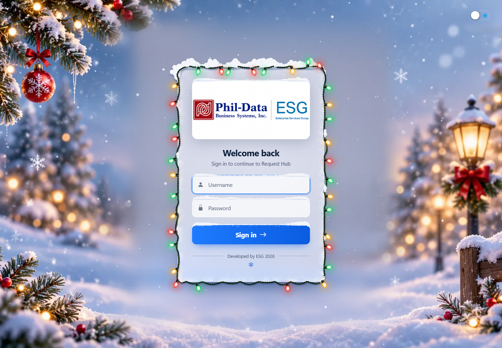

### Christmas login: desktop dark

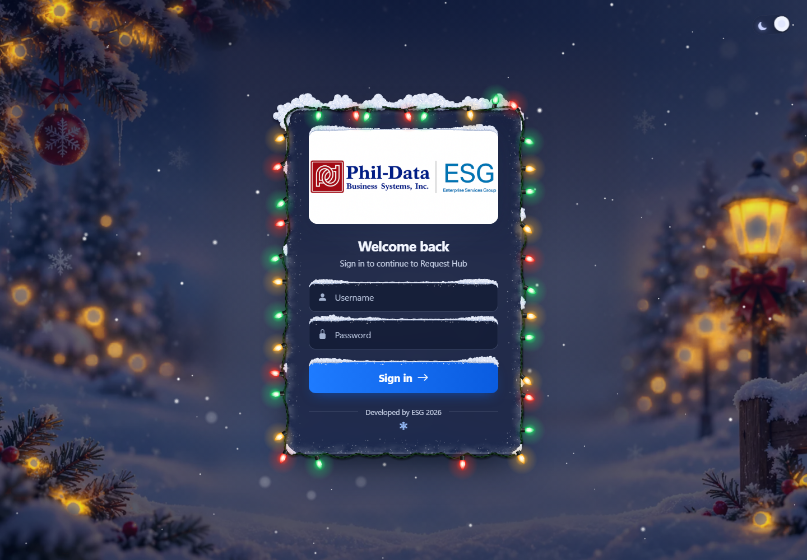

### Christmas login: mobile

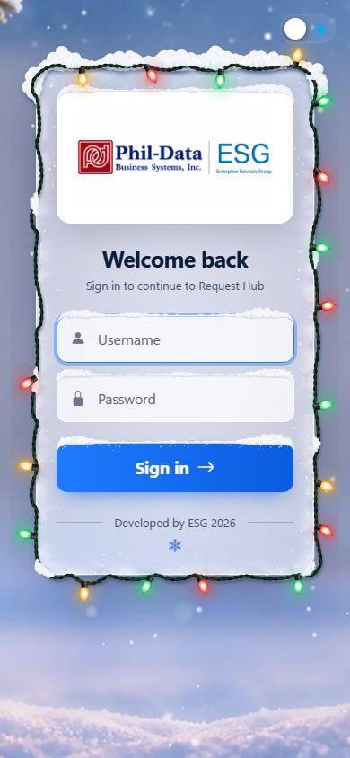

### Administrator dashboard and seasonal navbar

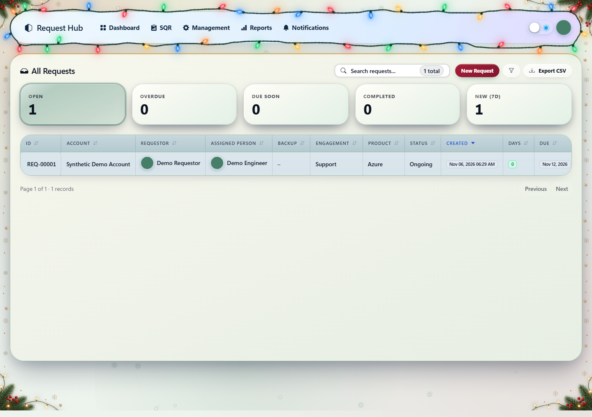

### Profile theme preview and effect preferences

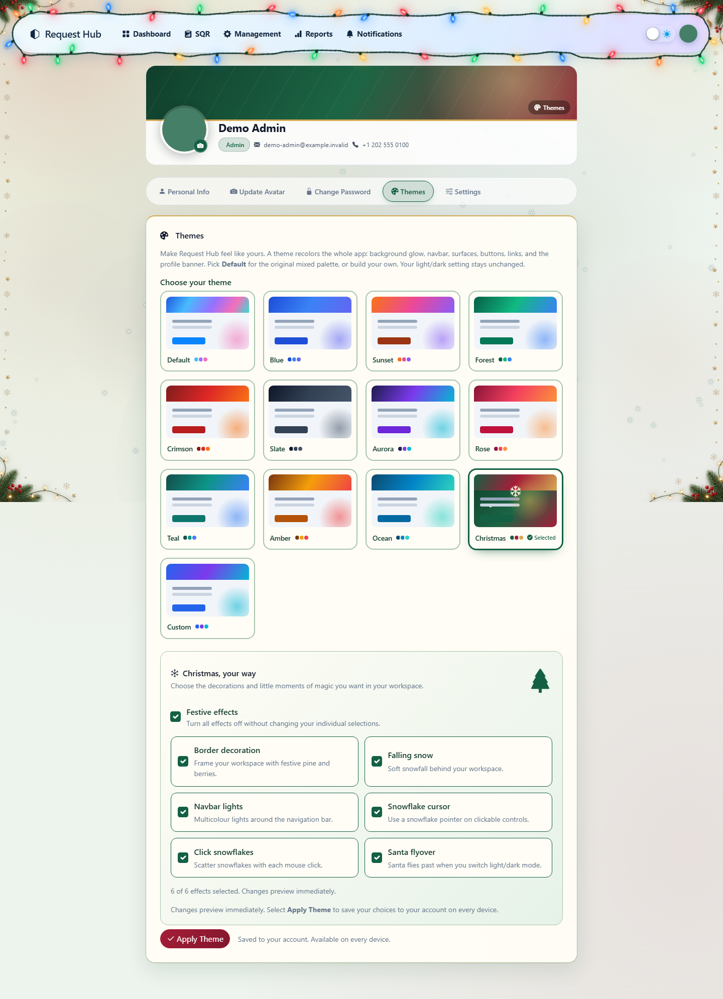

### Profile preview: dark mode

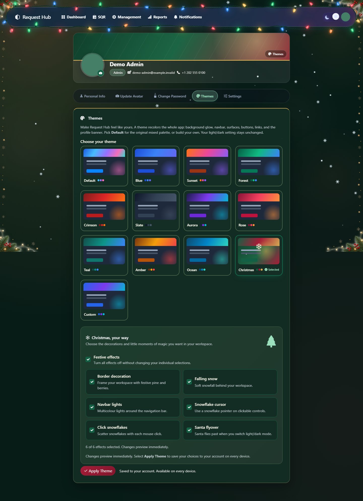

### Administrator request management

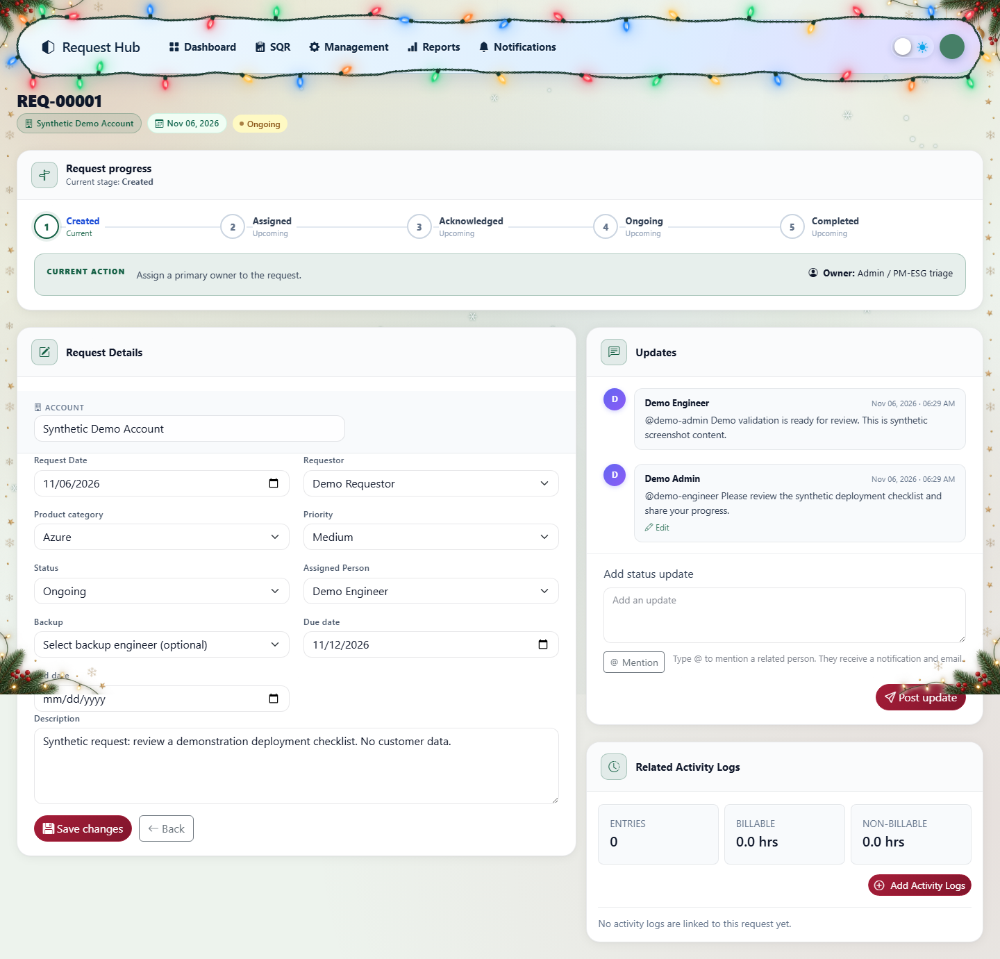

### Scoped mention suggestions

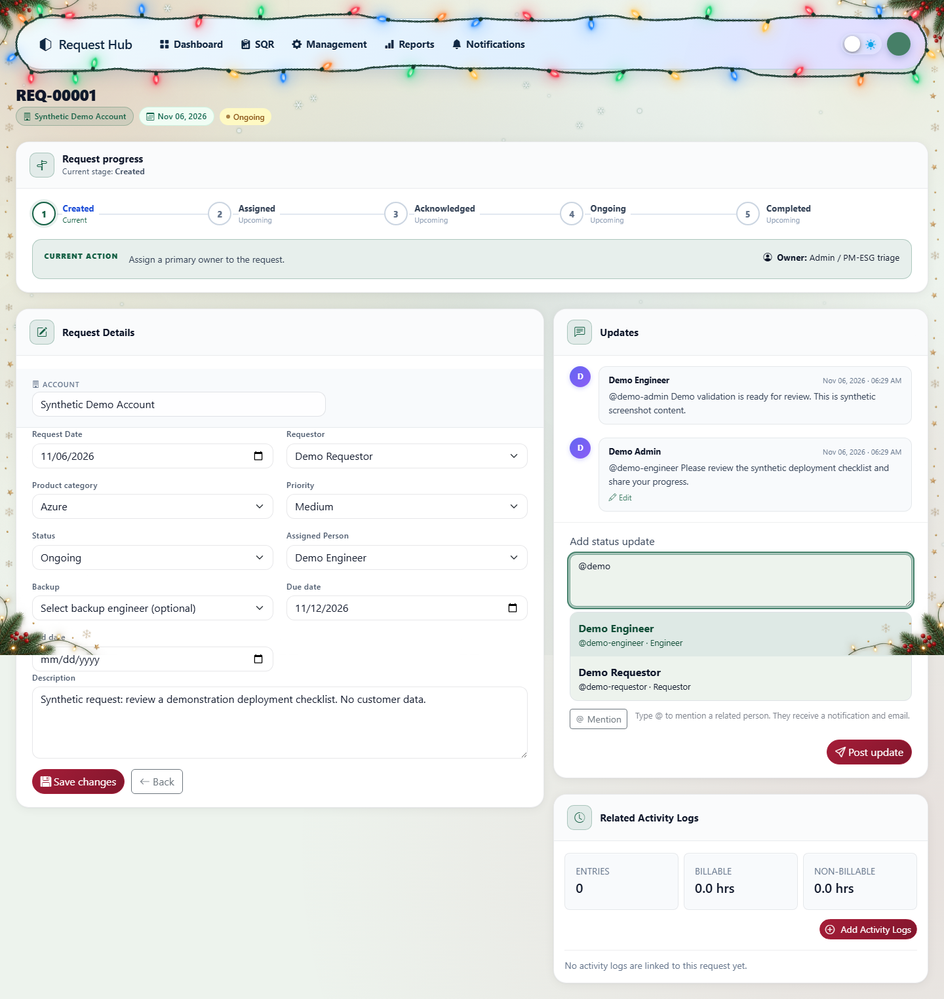

### Author update editing

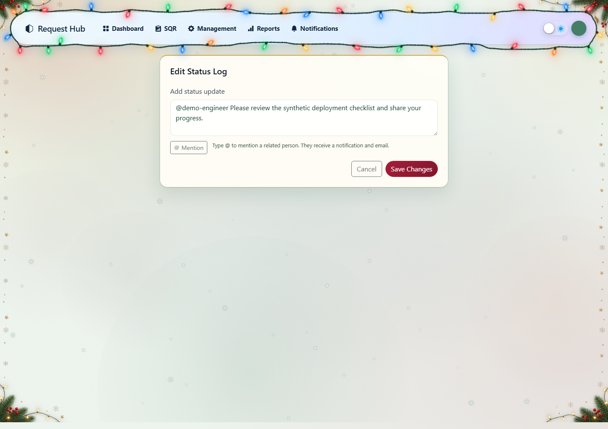

### Administrator activity logging


### Unread mention notifications and badge

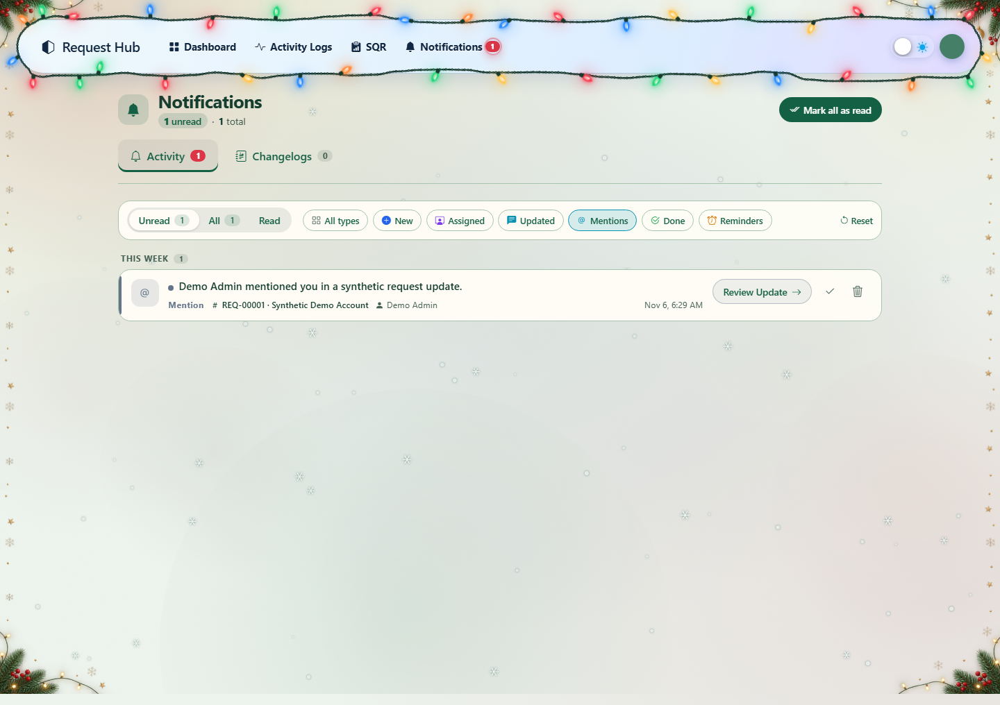

### Mentioned update anchor

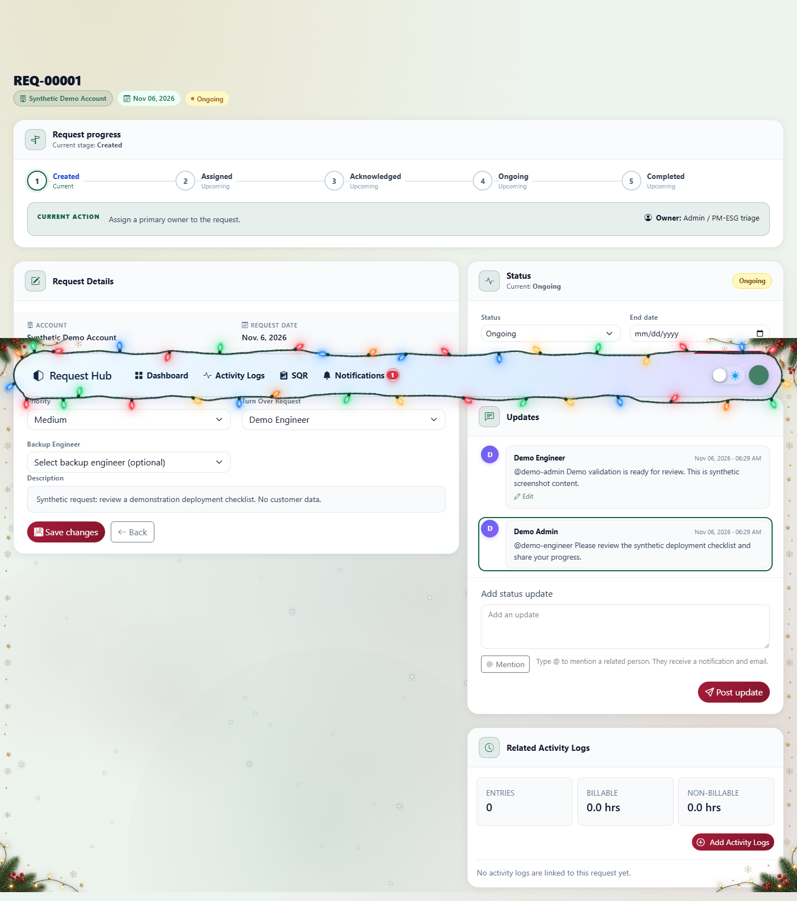

### Engineer activity logging

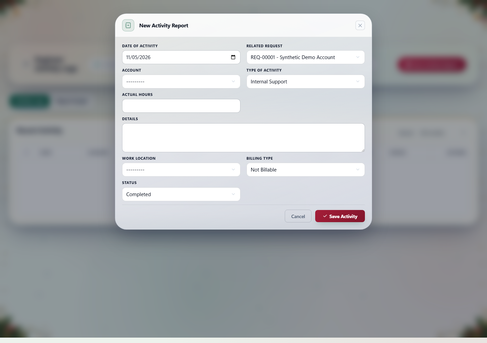

### Requestor dashboard reference links

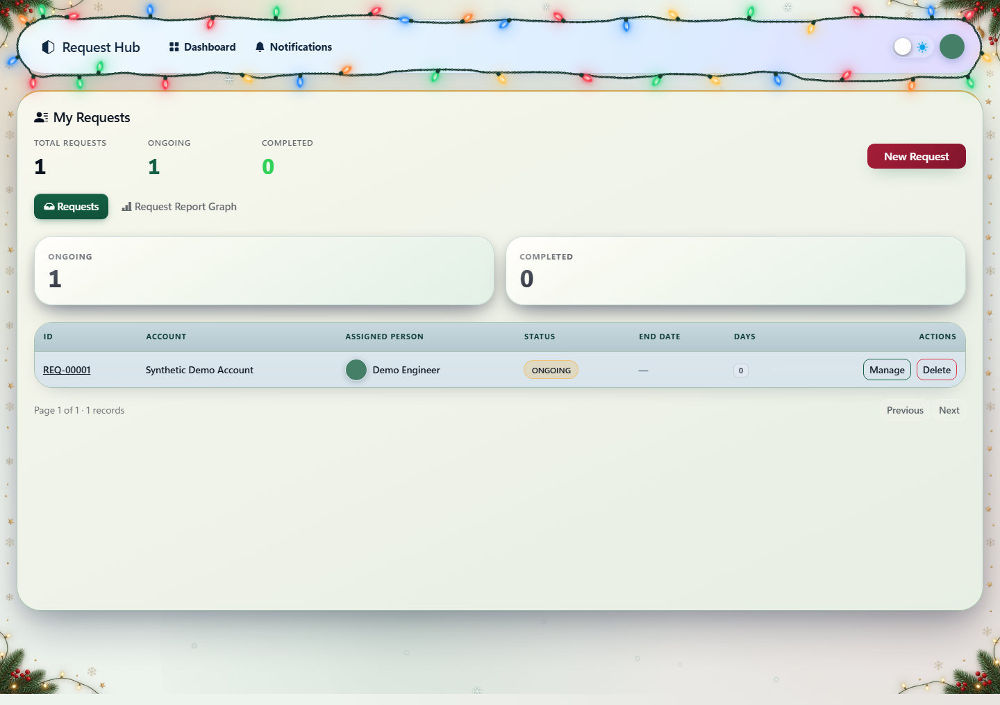

### Requestor collaboration without activity creation

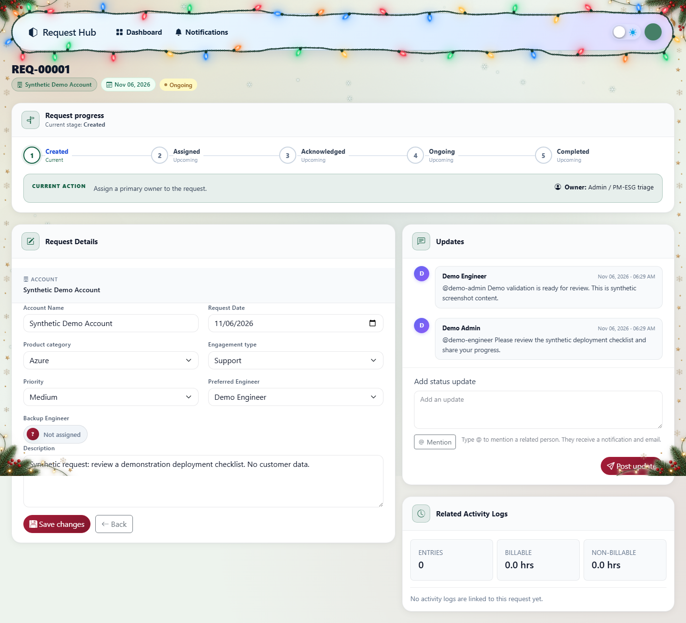

## Implementation notes and limitations

- [christmas-login.css](../static/css/christmas-login.css) and [christmas-login.js](../static/js/christmas-login.js) are empty placeholders, not the active login implementation.
- [christmas-login-scene.webp](../static/images/christmas-login-scene.webp) and [christmas-login.png](../static/images/christmas-login.png) have no discovered code/template references. They are present in the change set but are not the rendered login background.
- [request_detail.html](../templates/hub/request_detail.html) changes, but the named detail route redirects to collaborative management rather than rendering that template.
- [update_composer.html](../templates/hub/update_composer.html) is an included fragment, not a separately routed page.
- Static screenshots cannot depict a moving cursor, click-burst lifecycle, complete Santa flyover, or polling sequence; those behaviors are described above and have the listed test coverage.

## Complete application file inventory

**Modified** means an existing tracked file changed; **Added** means a previously untracked file. This inventory excludes the changelog and its generated screenshots.

| Status | File | Purpose |
|---|---|---|
| Modified | [README.md](../README.md) | Feature, role, email, and deployment guidance. |
| Modified | [request_hub/settings.py](../request_hub/settings.py) | Seasonal login feature switch. |
| Modified | [accounts/forms.py](../accounts/forms.py) | Christmas selection and effect preferences. |
| Modified | [accounts/models.py](../accounts/models.py) | Christmas choice and persistent preference fields. |
| Modified | [accounts/views.py](../accounts/views.py) | Theme preview and saved preference handling. |
| Modified | [accounts/test_themes.py](../accounts/test_themes.py) | Festive asset-contract checks. |
| Modified | [accounts/tests.py](../accounts/tests.py) | Theme preview/save smoke coverage. |
| Added | [accounts/migrations/0026_christmas_theme.py](../accounts/migrations/0026_christmas_theme.py) | Theme-choice migration. |
| Added | [accounts/migrations/0027_user_christmas_preferences.py](../accounts/migrations/0027_user_christmas_preferences.py) | Seven Boolean preferences. |
| Added | [accounts/test_christmas_login.py](../accounts/test_christmas_login.py) | Seasonal login tests. |
| Added | [accounts/test_christmas_preferences.py](../accounts/test_christmas_preferences.py) | Preference and preview tests. |
| Modified | [hub/context_processors.py](../hub/context_processors.py) | Consistent role-scoped unread counts. |
| Modified | [hub/forms.py](../hub/forms.py) | Mention validation and activity request selection. |
| Modified | [hub/models.py](../hub/models.py) | Mention notification event. |
| Modified | [hub/services/notifications.py](../hub/services/notifications.py) | Mention presentation and visibility. |
| Modified | [hub/views.py](../hub/views.py) | Mention delivery, notification refresh, permissions, and editing. |
| Modified | [hub/test_redirect_security.py](../hub/test_redirect_security.py) | Transaction-aware routing test adaptation. |
| Modified | [hub/tests.py](../hub/tests.py) | Activity role/access coverage. |
| Added | [hub/migrations/0058_notification_mentions.py](../hub/migrations/0058_notification_mentions.py) | Mention event-choice migration. |
| Added | [hub/migrations/0059_merge_20261106_0316.py](../hub/migrations/0059_merge_20261106_0316.py) | Migration branch merge. |
| Added | [hub/services/update_mentions.py](../hub/services/update_mentions.py) | Scoped mentions, deduplication, and email delivery. |
| Added | [hub/test_dashboard_request_links.py](../hub/test_dashboard_request_links.py) | Requestor-link coverage. |
| Added | [hub/test_update_mentions.py](../hub/test_update_mentions.py) | Server-side mention tests. |
| Modified | [scripts_check/test_notification_toasts.cjs](../scripts_check/test_notification_toasts.cjs) | Notification refresh/badge tests. |
| Added | [scripts_check/test_christmas_lights.cjs](../scripts_check/test_christmas_lights.cjs) | Navbar-light tests. |
| Added | [scripts_check/test_christmas_preview.cjs](../scripts_check/test_christmas_preview.cjs) | Preview reconciliation tests. |
| Added | [scripts_check/test_christmas_theme.cjs](../scripts_check/test_christmas_theme.cjs) | Christmas effects tests. |
| Added | [scripts_check/test_update_mentions.cjs](../scripts_check/test_update_mentions.cjs) | Mention-composer tests. |
| Modified | [static/css/account-themes.css](../static/css/account-themes.css) | Christmas theme styling integration. |
| Added | [static/css/christmas-lights.css](../static/css/christmas-lights.css) | Seasonal navbar overlay styling. |
| Added | [static/css/christmas-login.css](../static/css/christmas-login.css) | Empty legacy placeholder. |
| Added | [static/css/christmas-theme.css](../static/css/christmas-theme.css) | Christmas page surfaces and effects. |
| Added | [static/css/login-christmas.css](../static/css/login-christmas.css) | Active seasonal login styling. |
| Added | [static/hub/update_mentions.css](../static/hub/update_mentions.css) | Mention suggestions styling. |
| Modified | [static/js/notification-toasts.js](../static/js/notification-toasts.js) | Mention toasts, authoritative badges, and page refresh. |
| Added | [static/js/christmas-lights.js](../static/js/christmas-lights.js) | Responsive wire/bulb layout. |
| Added | [static/js/christmas-login.js](../static/js/christmas-login.js) | Empty legacy placeholder. |
| Added | [static/js/christmas-theme.js](../static/js/christmas-theme.js) | Preferences, effects, and preview lifecycle. |
| Added | [static/js/login-christmas.js](../static/js/login-christmas.js) | Active login decoration and snowfall. |
| Added | [static/js/update-mentions.js](../static/js/update-mentions.js) | Stakeholder suggestions and keyboard interactions. |
| Added | [static/images/christmas-cursor.svg](../static/images/christmas-cursor.svg) | Snowflake cursor. |
| Added | [static/images/christmas-frame.webp](../static/images/christmas-frame.webp) | Pine-and-berry frame. |
| Added | [static/images/christmas-login-scene.webp](../static/images/christmas-login-scene.webp) | Unreferenced alternative artwork. |
| Added | [static/images/christmas-login.png](../static/images/christmas-login.png) | Unreferenced alternative artwork. |
| Added | [static/images/christmas-santa-sleigh.svg](../static/images/christmas-santa-sleigh.svg) | Santa flyover artwork. |
| Added | [static/img/login-christmas-bg.webp](../static/img/login-christmas-bg.webp) | Active seasonal login scene. |
| Modified | [templates/accounts/login.html](../templates/accounts/login.html) | Conditional Christmas login markup/assets. |
| Modified | [templates/accounts/profile_form.html](../templates/accounts/profile_form.html) | Theme preview and effect controls. |
| Modified | [templates/base.html](../templates/base.html) | Christmas assets, memory, preferences, and navbar decoration. |
| Modified | [templates/hub/notifications.html](../templates/hub/notifications.html) | Mention category/presentation and refresh metadata. |
| Modified | [templates/hub/partials/dashboard_admin_rows.html](../templates/hub/partials/dashboard_admin_rows.html) | Requestor collaborative reference links. |
| Modified | [templates/hub/request_detail.html](../templates/hub/request_detail.html) | Timeline anchors and mention-aware composer inclusion. |
| Modified | [templates/hub/request_manager_form.html](../templates/hub/request_manager_form.html) | Shared composer, anchors, and activity-role controls. |
| Modified | [templates/hub/status_log_form.html](../templates/hub/status_log_form.html) | Shared composer for author edits. |
| Added | [templates/hub/update_composer.html](../templates/hub/update_composer.html) | Reusable mention-aware update fragment. |
