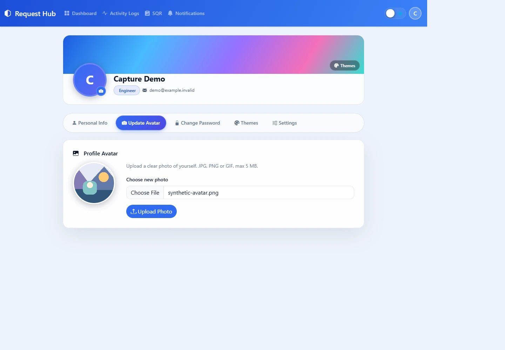
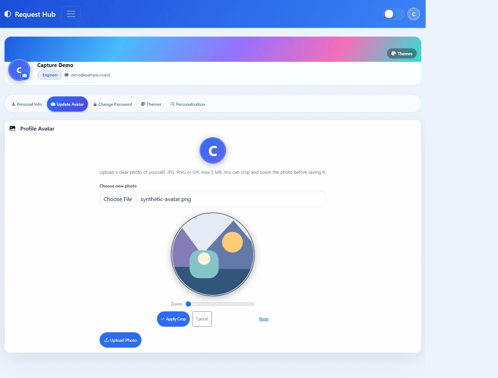
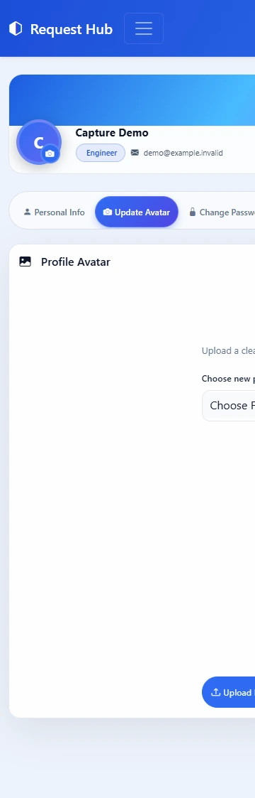
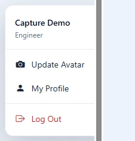
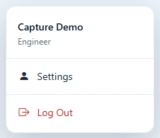

# Request Hub — v56.6 to v56.8

These retrospective entries describe the actual numbered releases on **November 6, 2026**, not newer changes on the development branch.

| Version | Release revision | Release evidence | UI/UX changes |
|---|---|---|---|
| v56.6 | `ec2c0c7772d994c5a62f99a5b8cf27db377ce4d0` | [Production Release run](https://github.com/lloydismael/request-hub/actions/runs/42140605786) | None |
| v56.7 | `49675f15a4d4b1d0848e18404287ffa4f8ed84f0` | [Production Release run](https://github.com/lloydismael/request-hub/actions/runs/42168231778) | None |
| v56.8 | `ee2e03ae5bf7b00507b8cfcc1fa256cc7807ae06` | [Production Release run](https://github.com/lloydismael/request-hub/actions/runs/42169516508) | Avatar cropping and account settings navigation |

## v56.6 — serial Django CI validation

**Change:** `c51ad3eb950907805607487464dc53702d048578`.

- **Before:** Container Security invoked Django validation with `--parallel auto`.
- **After:** Validation runs serially, retaining duration reporting, non-interactive execution, and verbose results.
- This changes the CI test runner only. No application or interface behavior changed, so there are no UI screenshots for this version.

Packaged entry: [v56.6 manifest](../hub/changelog_assets/v56.6/manifest.json).

## v56.7 — release checkpoint, no application changes

**Checkpoint:** `3bc1f5b7f91229e93b6ded45436932a6455faf50` (`Initial plan`).

- The application tree is identical to v56.6. The release contains an empty checkpoint commit and its merge, not a new feature or fix.
- Automatic changelogs normally exclude `Initial plan` commits, which explains the missing version entry.
- The curated entry explicitly records this as **maintenance**, using the real checkpoint SHA. The automatic generator's exclusion rules are unchanged.
- There are no UI/UX changes or corresponding screenshots.

Packaged entry: [v56.7 manifest](../hub/changelog_assets/v56.7/manifest.json).

## v56.8 — avatar cropping and clearer Settings navigation

**Change:** `ecc284e1dd19e208e4e843c0ba4a6fc009dd5204`. Although its subject mentions a v56.5 manifest, the commit also includes the following application changes.

### Avatar uploads

- Adds an inline crop stage with drag positioning, zoom, **Apply Crop**, **Cancel**, and **Reset** controls.
- Preserves **Upload Photo** as the save action and the existing 5 MB upload limit.
- Server processing applies EXIF orientation, center-crops images to a square, resizes large images to at most 1024 pixels per edge, and stores an optimized JPEG.

### Account settings navigation

- Replaces the separate **Update Avatar** and **My Profile** account-menu links with **Settings**.
- Renames the profile page to **Settings** and its preferences tab to **Personalization**.
- Updates assistant profile-navigation guidance to use the same **Settings** label.

### Restored changelog evidence

- Packages the historical v56.5 screenshot comparisons.
- Evidence sync fills missing fields in partially prepared comparisons and adds missing pairs, preserving prepared admin content and publication choices.
- Completing an existing draft does **not** automatically publish it; an admin must review and publish the restored entry.

The SQR review template changes in this release are comments-only. They do not introduce a functional or visual SQR change, so no SQR comparison is claimed.

Packaged entry: [v56.8 manifest](../hub/changelog_assets/v56.8/manifest.json).

### Historical before/after screenshots

The six screenshots use the **exact v56.7 and v56.8 templates, styles, and profile script**, the same unsaved synthetic profile, and an original 1200 × 800 geometric image. The profile captures use an application-style wrapper and the historical navbar; the account-menu captures apply the existing menu-open class. No live account data, database queries, form submissions, logout, or external messages were used.

- **Before revision:** `49675f15a4d4b1d0848e18404287ffa4f8ed84f0`.
- **After revision:** `ee2e03ae5bf7b00507b8cfcc1fa256cc7807ae06`.
- **Desktop viewport:** 1440 × 1000; **mobile viewport:** 375 × 844.
- Reduced motion is enabled. Profile captures retain the full rendered page height; menu captures are cropped to the menu with a small margin. Native scrollbars can reduce the screenshot width below the viewport width.
- Static screenshots demonstrate the visible controls and navigation changes, not server-side image processing or completed account updates.

| Screen | Before — v56.7 | After — v56.8 |
|---|---|---|
| Desktop avatar upload |  |  |
| Mobile avatar upload |  |  |
| Account menu |  |  |

## Importing the retrospective entries

Using the project's configured Python environment, explicitly import each packaged manifest. For PowerShell:

```powershell
.\.venv\Scripts\python.exe manage.py sync_release_changelog --manifest .\hub\changelog_assets\v56.6\manifest.json
.\.venv\Scripts\python.exe manage.py sync_release_changelog --manifest .\hub\changelog_assets\v56.7\manifest.json
.\.venv\Scripts\python.exe manage.py sync_release_changelog --manifest .\hub\changelog_assets\v56.8\manifest.json
```

The v56.7 import intentionally creates the maintenance checkpoint that the normal generator skips. The packaged-evidence pass otherwise enriches matching existing releases; it does not recreate every historical release automatically.

When importing older releases after newer ones, review the **Previous version** field in **Management → Changelogs**: v56.6 follows v56.5, v56.7 follows v56.6, and v56.8 follows v56.7. Review the completed v56.8 comparisons and explicitly publish an existing draft. Replaying imports does not duplicate release entries or stored screenshots.
