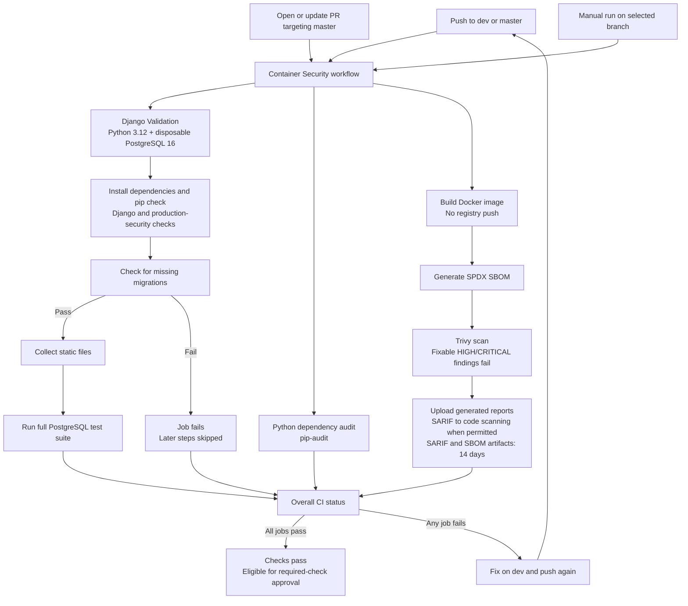

# Testing Request Hub CI

## What this workflow does

The workflow is `.github/workflows/container-security.yml`, displayed as **Container Security** in GitHub Actions.

| Trigger | Result |
| --- | --- |
| Push any commit to `dev` or `master` | Run all three CI jobs |
| Open or update a pull request targeting `master` | Run all three CI jobs |
| Run workflow manually | Run the workflow version on the selected branch |

There are no path filters. Application, template, and documentation changes all trigger CI on these branches. Runs for the same workflow/ref cancel superseded runs.

CI builds and scans a Docker image but does not push it to a registry or deploy the application. No production secrets are needed. PostgreSQL is disposable and uses CI-only credentials. The canonical public URL supports email-format assertions; it does not enable real email delivery or connect the database to production.

## Workflow visualization



The three jobs run independently. Any failed job makes CI fail, including a build or scanner error. Upload steps can still preserve files after a failure but cannot turn that failure into a pass. Reports are uploaded only when they exist; fork PRs skip the privileged code-scanning upload. Production deployment and image publishing are not part of this workflow.

## 1. Publish the correct workflow version

GitHub cannot run uncommitted local changes. First review the working tree:

```powershell
git branch --show-current
git status --short
git diff -- .github/workflows/container-security.yml README.md
```

Publish through your usual reviewed Git process. Work on `dev` for everyday CI testing. If you are currently on `master` or have unrelated changes, resolve how to transfer the intended changes to `dev` before switching branches or committing. Do not discard existing work or use `git add .` blindly.

Once on the intended branch, a selective commit can include:

```powershell
git add -- .github/workflows/container-security.yml README.md docs/ci-workflow-testing.md
git diff --cached
git commit -m "Add PostgreSQL-backed Django CI"
git push origin dev
```

Only use the last command when the commit is on `dev` and `origin` is the intended repository. These commands are instructions, not actions already performed by this guide.

## 2. Test the automatic dev trigger

1. Push the intended changes to `dev`.
2. Open https://github.com/lloydismael/RequestHub/actions.
3. Select **Container Security**.
4. Open the run for your commit. Confirm the event is **push**, the branch is `dev`, and the commit SHA matches your push.
5. Confirm that the run contains **Django Validation**, **Python dependency audit**, and **Build, scan, and publish SBOM**. Missing Django Validation usually means you ran an older workflow version.

No pull request is required for this test. Do not push to `master` merely to test CI.

## 3. Test manual execution

1. Open https://github.com/lloydismael/RequestHub/actions/workflows/container-security.yml.
2. Select **Run workflow**.
3. Select `dev`, then select **Run workflow** again to submit.
4. Open the new run and verify the event is **workflow_dispatch** and the selected branch/commit is correct.

The workflow must exist with `workflow_dispatch` on the repository's default branch for the manual trigger to be available. The selected branch must also contain the workflow. If the button is missing, check the default-branch workflow, repository Actions settings, and your write permissions. Do not bypass branch protection to enable it; use the normal review process.

Re-running an old failed run tests that run's original commit, not your latest local edits. Start a new run on the updated branch instead.

## 4. Test the pull-request trigger

1. Open a pull request with **base: master** and **compare: dev** after publishing your changes.
2. Check the PR's **Checks** tab for the three jobs and confirm the event is **pull_request**.
3. Push an additional reviewed change to `dev` if you need to verify that PR updates rerun checks. A push can create both a branch run and a PR run; that is expected.
4. Do not merge until required checks and review requirements pass. You do not need to merge simply to test the PR trigger.

GitHub normally tests the PR merge ref, so its checkout SHA can differ from the branch-head SHA. Verify the PR/run association rather than expecting those SHAs to match.

## 5. Inspect results

| Job | Expected checks |
| --- | --- |
| Django Validation | Dependency installation and `pip check`; Django configuration; production-security configuration; missing migrations; static collection; full tests with PostgreSQL 16 |
| Python dependency audit | `pip-audit` completes without reported blocking vulnerabilities |
| Build, scan, and publish SBOM | Docker build succeeds; SPDX SBOM generated; Trivy finds no fixable HIGH/CRITICAL vulnerabilities; applicable uploads succeed |

Open each job, expand the first failed step, and read its original error. Later skipped steps are generally consequences, not separate root causes. Independent jobs can pass even if another job fails.

On the run summary, check **Artifacts** for `request-hub-trivy-results` and `request-hub-sbom`. They are retained for 14 days when generated. A Docker build failure produces neither report; their upload steps should be skipped without a missing-file error. A vulnerability finding should keep the run red while generated artifacts are still uploaded. Fork PRs skip the privileged SARIF upload but can retain report artifacts.

## Validation baseline and migration fix

Local implementation validation on October 21, 2026 confirmed a successful Docker build, Django configuration and production-security checks, static collection, and 246 passing tests against disposable PostgreSQL 16. This is not proof of a successful GitHub run or a current clean vulnerability scan.

The missing-migration check previously detected a display-label change from `Over` to `Overdue` for `SqrProjectPerformance.budget_health`, `schedule_health`, and `scope_health`. Migration `0049_alter_sqrprojectperformance_budget_health_and_more.py` now records those choices while preserving the stored value `over`. The local migration-state check reports `No changes detected` after adding it. Commit and push the migration before expecting the remote check to pass; older commits still lack it.

For future missing-migration failures, have the owning developer generate, review, and test the appropriate migration in the normal development environment, then commit it with the model changes. Do not edit historical migrations or disable the CI gate just to make the run green.

## Pipeline speed

Baseline from the `master` run on October 22, 2026: the Django Validation job took about 200 seconds, of which the test suite was 163 seconds. The other two jobs run in parallel and finish in under 70 seconds, so test time sets total CI time. Speed measures:

- **Fast password hasher for tests.** `python manage.py test --settings=request_hub.settings_ci` swaps PBKDF2 for MD5 (see `request_hub/settings_ci.py`). Hundreds of tests create users or log in, and PBKDF2 cost dominated runtime. The production-security checks still use the real settings. Never point a deployed process at `settings_ci`.
- **Parallel tests.** `--parallel auto` uses every runner CPU. `tblib` (via `requirements-ci.txt`) is required so a failing test reports its traceback instead of aborting the parallel runner and cascading into "database does not exist" errors.
- **Docker layer cache.** The image build restores dependency layers from the GitHub Actions cache. Per-build values (`APP_VERSION`, `VCS_REF`, `BUILD_DATE`) are declared late in the `Dockerfile` so they no longer invalidate the dependency layers. `APK_REFRESH` receives the run ID so OS packages are upgraded on every build; Trivy still scans a fresh package set.
- **pip cache** for the Django and audit jobs.

Local measurement on the same 351 tests against disposable PostgreSQL 16: 203 seconds serial with PBKDF2, 63 seconds serial with the fast hasher, and 29-33 seconds with 4 parallel workers. A Docker rebuild with a new version and a source change dropped from 35-42 seconds to 6 seconds with warm layers. Compare these with the `Run application tests` and `Build image` step durations in a real run; the 4-vCPU public-repository runner will differ from a workstation.

To clear a suspected stale cache, delete the `request-hub-image` entries under **Actions > Caches**. Manual `docker build --no-cache` remains valid and still refreshes everything.

## Troubleshooting

| Symptom | What to check |
| --- | --- |
| No run after pushing | Changes actually pushed; branch is `dev`/`master`; workflow exists on that branch; Actions enabled; no skip-CI commit directive |
| Only two jobs | The remote branch still has the old workflow |
| PostgreSQL connection failure | Service startup/health logs and disposable database configuration, not production settings |
| Docker fails with missing `pg_config` | Runtime/dependency compatibility; the previous Python 3.14 PR tried to build the locked PostgreSQL driver from source |
| Dependency audit or Trivy fails | Review actual findings and compatible dependency/base-image fixes; do not weaken failure thresholds |
| SARIF permission error | Repository code-scanning availability and token permissions; report artifacts remain separate evidence |
| A run is cancelled | A newer run for the same workflow/ref superseded it |

## Completion checklist

- A `dev` push runs all three jobs on the expected commit.
- A PR targeting `master` runs all three jobs.
- Manual execution works when the default branch exposes the trigger.
- Configuration, migration, static-file, and PostgreSQL test gates pass.
- Dependency audit and Docker security scan pass; expected artifacts are present.
- No image is published and no production resource is changed.
- After successful runs, a repository administrator configures `master` protection to require the three job checks and PR review. The YAML does not enable branch protection automatically.